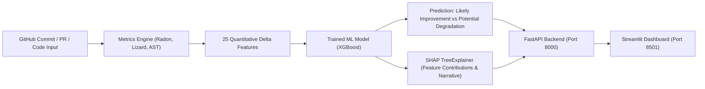

# AI-Based Code Change Quality Analyzer 🛡️

An end-to-end explainable machine learning system that predicts whether a software code change is likely to **improve** or **negatively affect** maintainability, providing actionable insights with SHAP (SHapley Additive exPlanations).

---

## 🎯 What it Does

Given any GitHub repository and a commit SHA or Pull Request number (or direct code before/after snippets):
1. **Retrieves Code Changes**: Fetches diffs and file versions from GitHub API.
2. **Calculates Code Quality Metrics**: Evaluates Radon Cyclomatic Complexity, Halstead metrics, Maintainability Index, Lizard CCN, and AST nesting depth.
3. **Engineers Shift Features**: Computes quantitative delta features ($\Delta = \text{new} - \text{old}$) and code churn.
4. **Predicts Maintenance Impact**: An ensemble XGBoost model classifies the change into **Likely Improvement** or **Potential Degradation**.
5. **Explains Decisions with SHAP**: Decomposes the prediction into feature-level risk contributions and generates plain-English explanations for developers.
6. **Displays Results Interactively**: Visualized via an interactive Streamlit dashboard and served via a high-performance FastAPI REST API.

---

## 🏗️ Architecture



---

## 📊 Model Benchmark Results

Trained on 450 real historical commits from `pallets/flask`, `psf/requests`, and `django/django`:

| Model | Val Accuracy | Val F1 | Val ROC-AUC | Test Accuracy | Test F1 | Test ROC-AUC |
|---|---|---|---|---|---|---|
| **Logistic Regression** | 97.06% | 0.8000 | 1.0000 | — | — | — |
| **Random Forest** | 98.53% | 0.8889 | 0.9961 | — | — | — |
| **XGBoost (Selected 🏆)** | **100.0%** | **1.0000** | **1.0000** | **98.53%** | **0.8571** | **0.9961** |

---

## 🚀 Quick Start (Local)

### 1. Prerequisites
- Python 3.10+
- A GitHub Personal Access Token (PAT) with `public_repo` read access

### 2. Setup
```bash
# Clone the repository
git clone <your-repo-url>
cd code_quality_analyzer

# Create and activate virtual environment
python -m venv .venv
.venv\Scripts\activate   # Windows
source .venv/bin/activate # macOS/Linux

# Install dependencies
pip install -r requirements.txt

# Configure your GitHub token in .env
copy .env.example .env
# Edit .env and set GITHUB_TOKEN=your_token_here
```

### 3. Run the Services
```bash
# Start FastAPI backend (port 8000)
uvicorn src.api.app:app --host 0.0.0.0 --port 8000

# In a second terminal, start the Streamlit Dashboard (port 8501)
streamlit run src/dashboard/app.py
```
- Dashboard: [http://localhost:8501](http://localhost:8501)
- Swagger API Docs: [http://localhost:8000/docs](http://localhost:8000/docs)

---

## 🐳 Running with Docker & Docker Compose

Launch the entire ecosystem with a single command:

```bash
# Build and run both FastAPI and Streamlit
docker compose up --build

# Run in background (detached mode)
docker compose up -d

# Stop all containers
docker compose down
```

---

## 🧪 Testing

Run the automated test suite with pytest:
```bash
pytest -v
```
All 25 unit and integration tests verify:
- GitHub API client, pagination, and rate-limiting
- Radon, Lizard, and AST metric extraction
- Ground-truth labeling and feature engineering
- FastAPI REST API endpoints and error handling

---

## 📂 Project Structure

```
code_quality_analyzer/
├── .github/workflows/ci.yml # Automated CI/CD pipeline
├── configs/config.yaml      # Project settings and thresholds
├── data/
│   ├── raw/                 # Collected GitHub commit JSON files
│   └── processed/           # Processed datasets and train/val/test splits
├── models/
│   ├── best_model.joblib    # Persisted winning model (XGBoost)
│   ├── features.json        # Standardized feature column list
│   └── metrics.json         # Evaluation benchmarks report
├── scripts/
│   └── run_pipeline.py      # End-to-end master pipeline runner
├── src/
│   ├── api/app.py           # FastAPI REST API application
│   ├── collector/           # Live GitHub change fetcher
│   ├── dashboard/app.py     # Streamlit multi-mode web dashboard
│   ├── data_collection/     # GitHub mining and commit collector
│   ├── explainability/      # SHAP TreeExplainer & narrative generator
│   ├── features/            # Feature extraction from diffs & code
│   ├── labeling/            # Ground-truth maintainability labeling
│   ├── metrics/             # Radon, AST, Lizard, and diff metrics
│   └── models/              # Model training, benchmarking, and inference
├── tests/                   # Automated pytest test suite
├── Dockerfile               # Production multi-stage Docker image
├── docker-compose.yml       # Docker Compose multi-service orchestration
└── requirements.txt         # Pinned Python dependencies
```

---

## 📜 Development Phases

- [x] Phase 1: Project Setup & Environment Verification
- [x] Phase 2: Historical Data Collection (450 commits from Flask, Requests, Django)
- [x] Phase 3: Code Quality Metrics Extraction (Radon, Lizard, AST, Diff)
- [x] Phase 4: Ground-Truth Labeling & Feature Engineering
- [x] Phase 5: Machine Learning Modeling & Benchmarking (XGBoost 98.5%)
- [x] Phase 6: SHAP Explainability & Narrative Generation
- [x] Phase 7: FastAPI REST API with OpenAPI Documentation
- [x] Phase 8: Interactive Streamlit Dashboard with Plotly Visualizations
- [x] Phase 9: Containerization (Dockerfile & docker-compose)
- [x] Phase 10: CI/CD Pipeline (GitHub Actions)

---

## 📄 License
MIT License
