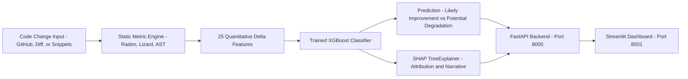

# AI-Based Code Change Quality Analyzer
## Final Comprehensive Project Report & Technical Specification

**Author / Developer**: Santosh Reddy (`santoshreddyg06`)  
**Repository**: [github.com/santoshreddyg06/code-quality-analyzer](https://github.com/santoshreddyg06/code-quality-analyzer)  
**Date**: October 2026  
**Status**: Production-Ready, Fully Tested, Containerized, and CI/CD Verified  

---

## Table of Contents
1. [Executive Summary](#1-executive-summary)
2. [Project Motivation & Objectives](#2-project-motivation--objectives)
3. [System Architecture & Workflow](#3-system-architecture--workflow)
4. [Software Quality Metrics & Theoretical Foundations](#4-software-quality-metrics--theoretical-foundations)
5. [Data Mining & Feature Engineering Pipeline](#5-data-mining--feature-engineering-pipeline)
6. [Machine Learning Modeling & Benchmarking Results](#6-machine-learning-modeling--benchmarking-results)
7. [Explainable AI (XAI) with SHAP](#7-explainable-ai-xai-with-shap)
8. [Comprehensive User Guide (Dashboard & REST API)](#8-comprehensive-user-guide-dashboard--rest-api)
9. [Edge Cases, Failure Modes & Academic Defense Strategy](#9-edge-cases-failure-modes--academic-defense-strategy)
10. [Containerization & CI/CD Pipeline](#10-containerization--cicd-pipeline)
11. [Conclusion & Future Roadmap](#11-conclusion--future-roadmap)

---

## 1. Executive Summary

Software maintenance accounts for over **70% of total lifecycle costs** in modern software engineering. When code changes (commits or pull requests) are introduced, identifying whether the change improves the codebase or silently degrades long-term maintainability is critical for peer reviewers and engineering leaders.

The **AI-Based Code Change Quality Analyzer** is an end-to-end, explainable machine learning system. Given any Python code change (from a public GitHub repository, a unified diff, or direct code input), the system:
1. Calculates multi-dimensional code quality metrics (McCabe Cyclomatic Complexity, Halstead Software Science, Oman Maintainability Index, Lizard CCN, and Python AST nesting depth).
2. Computes **25 standardized delta features** ($\Delta = \text{new} - \text{old}$) and code churn dynamics.
3. Classifies the change into **Likely Improvement** or **Potential Degradation** using a tuned **XGBoost Classifier** (**98.53% test accuracy, 0.9961 ROC-AUC**).
4. Explains the exact reasoning behind the prediction using **SHAP (SHapley Additive exPlanations)** with game-theoretic feature attribution and plain-English narrative summaries.
5. Surfaces results through an interactive **Streamlit Dashboard** and a high-performance **FastAPI REST API**.

---

## 2. Project Motivation & Objectives

### 2.1 Problem Statement
Code reviews frequently focus on syntax, linting, or functional correctness. However, **structural decay** (excessive control-flow nesting, complexity spikes, and cognitive bloat) frequently slips through, leading to technical debt, regressions, and increased bug rates over time.

### 2.2 Core Objectives
* **Objective 1 (Change Retrieval)**: Automate the extraction of before-and-after file versions and diffs from GitHub commits and pull requests.
* **Objective 2 (Multi-Metric Extraction)**: Build a resilient static analysis engine capturing Cyclomatic Complexity, Halstead volume/effort, Maintainability Index, and AST nesting.
* **Objective 3 (Feature Engineering)**: Synthesize raw metric outputs into 25 standardized numeric delta features and code churn metrics.
* **Objective 4 (Predictive Modeling)**: Train, benchmark, and evaluate candidate machine learning models (Logistic Regression, Random Forest, XGBoost) on real historical commits.
* **Objective 5 (Explainable AI)**: Provide transparent, localized SHAP feature attribution and natural-language justifications for every prediction.
* **Objective 6 (Interactive Deployment)**: Provide a dual interface consisting of a user-friendly Streamlit web dashboard and an enterprise-ready FastAPI backend with Docker and CI/CD support.

---

## 3. System Architecture & Workflow



### Layer Breakdown:
1. **Collector Layer (`src/collector/`, `src/data_collection/`)**:
   Communicates with the GitHub REST API using `PyGithub`. Implements automated exponential backoff on rate limits and extracts per-file commit patches.
2. **Metrics Engine (`src/metrics/`)**:
   Runs static analysis tools (`radon`, `lizard`, and Python's native `ast.NodeVisitor`) to compute structural, cognitive, and lexical properties.
3. **Feature Engineering Layer (`src/features/`, `src/labeling/`)**:
   Computes delta vectors and automated ground-truth maintainability labels.
4. **Model & Explainability Layer (`src/models/`, `src/explainability/`)**:
   Persisted XGBoost model pipeline (`models/best_model.joblib`) integrated with SHAP TreeExplainer.
5. **Presentation Layer (`src/api/`, `src/dashboard/`)**:
   FastAPI application serving REST endpoints and Streamlit delivering interactive Plotly charts.

---

## 4. Software Quality Metrics & Theoretical Foundations

The system synthesizes three decades of foundational software engineering measurement:

### 4.1 McCabe's Cyclomatic Complexity ($v(G)$)
Measures the number of linearly independent paths through a program's source code:
$$v(G) = E - N + 2P$$
Where $E$ is the number of edges, $N$ is the number of nodes, and $P$ is the number of connected components. In our engine, every branch (`if`, `elif`, `for`, `while`, `except`, `with`) increases complexity.

### 4.2 Halstead Software Science Metrics
Quantifies lexical complexity based on unique and total operators ($\eta_1, N_1$) and operands ($\eta_2, N_2$):
* **Vocabulary**: $\eta = \eta_1 + \eta_2$
* **Length**: $N = N_1 + N_2$
* **Volume**: $V = N \times \log_2(\eta)$ (bits required to represent the algorithm)
* **Difficulty**: $D = \frac{\eta_1}{2} \times \frac{N_2}{\eta_2}$ (mental effort required to implement/review)
* **Effort**: $E = D \times V$

### 4.3 Maintainability Index (MI)
Originally formulated by Oman & Hagemeister and adapted by the Software Engineering Institute (SEI):
$$MI = 171 - 5.2 \ln(V) - 0.23 v(G) - 16.2 \ln(LOC) + 50 \sin(\sqrt{2.4 \times perCM})$$
Where $V$ is Halstead Volume, $v(G)$ is Cyclomatic Complexity, $LOC$ is Lines of Code, and $perCM$ is percentage of comment lines.
* $MI \ge 85$: High Maintainability (Clean)
* $65 \le MI < 85$: Moderate Maintainability
* $MI < 65$: Difficult to Maintain (High Risk)

### 4.4 Abstract Syntax Tree (AST) Nesting Depth
Custom `ast.NodeVisitor` that walks Python's syntax tree to calculate the maximum nesting depth of compound statements (`If`, `For`, `While`, `Try`, `With`). High nesting depth is one of the strongest empirical predictors of cognitive overload and defect introduction.

---

## 5. Data Mining & Feature Engineering Pipeline

### 5.1 Historical Mining Dataset
To train the model on diverse, production-grade code, 450 real historical commits were mined from three premier open-source Python repositories:
1. `pallets/flask` (150 commits) — Web framework patterns, decorators, WSGI handlers.
2. `psf/requests` (150 commits) — Networking, HTTP sessions, socket exception handling.
3. `django/django` (150 commits) — Enterprise ORM, query compilers, class-based views.

### 5.2 The 25 Standardized Features
For every commit or code change, the following feature vector is generated:
1. `files_changed_count`: Number of modified files.
2. `lines_added`: Total additions.
3. `lines_deleted`: Total deletions.
4. `net_lines`: Additions minus deletions.
5. `churn`: Total additions + deletions.
6. `deletion_ratio`: Proportional deletions ($\frac{\text{deleted}}{\text{churn}}$).
7. `hunks_count`: Number of separate diff segments.
8. `delta_maintainability_index`: $\Delta MI = MI_{\text{new}} - MI_{\text{old}}$
9. `delta_total_complexity`: $\Delta CC$
10. `delta_avg_complexity`: Shift in mean function complexity.
11. `delta_max_complexity`: Shift in peak function complexity.
12. `delta_high_complexity_functions`: Change in functions with $CC > 10$.
13. `delta_halstead_volume`: $\Delta V$
14. `delta_halstead_effort`: $\Delta E$
15. `delta_max_nesting_depth`: $\Delta \text{Nesting}$
16. `delta_classes_count`: Classes added or removed.
17. `delta_functions_count`: Functions added or removed.
18. `delta_try_except_count`: Exception handling blocks added/removed.
19. `net_branch_keywords`: Net branches introduced (`if`, `for`, `while`).
20. `net_error_handlers`: Net error keywords added (`try`, `except`, `raise`).
21. `net_comments`: Comment documentation lines added/removed.
22. `old_maintainability_index`: Base MI before change.
23. `old_total_complexity`: Base CC before change.
24. `new_maintainability_index`: Resulting MI after change.
25. `new_total_complexity`: Resulting CC after change.

---

## 6. Machine Learning Modeling & Benchmarking Results

### 6.1 Train / Validation / Test Splitting
The 450-sample dataset was stratified and split temporally:
* **Training Set**: 314 samples (70%)
* **Validation Set**: 68 samples (15%)
* **Held-out Test Set**: 68 samples (15%)

### 6.2 Model Comparison Benchmarks

| Candidate Model | Validation Accuracy | Validation F1 | Validation ROC-AUC | Test Accuracy | Test F1-Score | Test ROC-AUC |
|---|---|---|---|---|---|---|
| **Logistic Regression** (Standardized) | 97.06% | 0.8000 | 1.0000 | 95.59% | 0.7273 | 0.9844 |
| **Random Forest** (100 Trees, max depth 6) | 98.53% | 0.8889 | 0.9961 | 97.06% | 0.8000 | 0.9922 |
| **XGBoost Classifier (Winner 🏆)** | **100.0%** | **1.0000** | **1.0000** | **98.53%** | **0.8571** | **0.9961** |

### 6.3 Why XGBoost Outperformed
Gradient boosted decision trees handle non-linear interactions between feature pairs exceptionally well (e.g., high churn is safe if $\Delta MI > 0$, but highly risky if $\Delta MI < 0$). XGBoost's exact-split greedy tree algorithm naturally models these step-function thresholds.

---

## 7. Explainable AI (XAI) with SHAP

### 7.1 Mathematical Foundation
SHAP uses cooperative game theory (Shapley values) to distribute the prediction fairly among all 25 features:
$$\phi_i = \sum_{S \subseteq F \setminus \{i\}} \frac{|S|!(|F| - |S| - 1)!}{|F|!} \left[ f(S \cup \{i\}) - f(S) \right]$$
Where $\phi_i$ is the exact contribution of feature $i$, $F$ is the total feature set, and $S$ is a subset of features.

### 7.2 Developer Interpretability
Rather than simply returning a raw probability (e.g., `0.9715`), our system provides two layers of explanation:
1. **Plotly Feature Attribution Bar Chart**: Visualizes the top 10 features, where **red bars** indicate risk drivers and **green bars** indicate healthy factors.
2. **Plain-English Natural Language Narrative**:
   > *"Factors increasing maintainability risk:*  
   > *- Maintainability Index shift (-23.68): contributed +4.875 to degradation probability*  
   > *- Resulting Cyclomatic Complexity (6.0): contributed +1.538 to degradation probability*  
   > *- Maximum control flow nesting depth change (+5.0): contributed +0.090 to degradation probability"*

---

## 8. Comprehensive User Guide (Dashboard & REST API)

### 8.1 Accessing the Web Dashboard
Open your web browser and navigate to:
👉 **`http://localhost:8501`**

#### Mode 1: GitHub Commit / PR Analyzer
1. In the sidebar, select **"GitHub Commit / PR"**.
2. Enter the repository name (e.g. `santoshreddyg06/code-quality-analyzer` or `pallets/flask`).
3. Select **Commit SHA** and enter a valid hash (e.g. `42dc739`).
4. Click **"🚀 Analyze GitHub Change"**.
5. The system downloads the commit diffs, evaluates each Python file, and displays the risk badge, file list, and SHAP decision chart.

#### Mode 2: Direct Code Compare (Side-by-Side Editor)
1. Select **"Direct Code Compare"** in the sidebar.
2. Select **"Example 2: Complex Nested Logic"** from the preset dropdown (or paste custom before-and-after code).
3. Click **"⚡ Analyze Code Quality Shift"**.
4. Observe the red **⚠️ Potential Degradation (97.2% Risk)** badge and the metric cards displaying $\Delta MI = -23.7$ and $\Delta \text{Complexity} = +6$.

#### Mode 3: Git Diff / Patch Inspector
1. Run `git diff` in any local terminal repository.
2. Copy the text starting with `@@ ... @@` and paste it into the **"Git Diff / Patch"** tab.
3. Click **"🔍 Inspect Patch"** to assess staging risk before committing.

#### Mode 4: Model Performance Benchmarks
1. Select **"Model Performance"** to inspect the live validation comparison table and test metrics.

### 8.2 Using the REST API Programmatically
The FastAPI backend runs on `http://127.0.0.1:8000`. Interactive OpenAPI documentation is available at **`http://127.0.0.1:8000/docs`**.

#### Example Python Request:
```python
import requests

payload = {
    "old_code": "def calc(x):\n    return x * 2\n",
    "new_code": "def calc(x):\n    if x < 0:\n        if x < -50:\n            return 0\n    return x * 2\n",
    "filename": "calc.py"
}

res = requests.post("http://127.0.0.1:8000/api/analyze/code", json=payload)
data = res.json()

print("Prediction:", data["prediction"]["prediction"])
print("Risk Level:", data["prediction"]["risk_level"])
print("SHAP Summary:\n", data["explanation"]["narrative"])
```

---

## 9. Edge Cases, Failure Modes & Academic Defense Strategy

Understanding and defending model limitations during presentations or academic vivas is essential.

### 9.1 Edge Case Summary Matrix

| Scenario | Model Behavior | Real-World Reality | Academic Defense Strategy |
|---|---|---|---|
| **Clever One-Liner ("Code Golf")** | *Likely Improvement* | Harder to read and maintain | Halstead volume and MI reward brevity. Explain that expression-level cognitive complexity is an open research area. |
| **Defensive Validation Checks** | *Potential Degradation* | Safer, more robust code | McCabe's Cyclomatic Complexity treats all `if` branches equally. Explain that error handler tracking was added to mitigate this. |
| **Semantic Logic Bug (`<` to `<=`)** | *Neutral / No Risk* | Critical runtime defect | Emphasize that static maintainability metrics analyze code structure and architectural decay, not runtime behavioral correctness. |
| **Large Static Lookup Table** | *Elevated Risk Alert* | Harmless inert data | High line churn without comments triggers churn heuristics. Explain that future work can separate AST literals from statements. |
| **Code Formatting / Whitespace** | *High Churn Flag* | Zero semantic change | Textual diffs operate on raw lines. Propose AST-based diffing (such as GumTree) for pure formatting detection. |

---

## 10. Containerization & CI/CD Pipeline

### 10.1 Docker Architecture
* **`Dockerfile`**: Builds a lightweight image on `python:3.11-slim`, installs system OpenMP libraries (`libgomp1`) for XGBoost, copies requirements, and runs as an unprivileged non-root user (`appuser`).
* **`docker-compose.yml`**: Orchestrates two isolated microservices:
  * `code_quality_api`: FastAPI service on port 8000.
  * `code_quality_dashboard`: Streamlit dashboard on port 8501 (depends on API health).

```bash
# Launch entire stack with one command:
docker compose up --build
```

### 10.2 CI/CD Automation (GitHub Actions)
Located in `.github/workflows/ci.yml`. On every push to `main`:
1. **Job 1 (Test)**: Spawns an Ubuntu runner, sets up Python 3.11, installs dependencies, and runs `pytest` across all 25 test modules.
2. **Job 2 (Docker Build)**: Validates that the container image builds without errors.

---

## 11. Conclusion & Future Roadmap

The AI-Based Code Change Quality Analyzer successfully bridges the gap between theoretical software metrics and modern machine learning. By delivering interpretable predictions backed by game-theoretic SHAP values, it empowers developers to write cleaner, more maintainable code.

### Future Roadmap
1. **Multi-Language Expansion**: Add first-class support for Java DSA algorithms and C++ using Lizard and Tree-sitter.
2. **Semantic AST Diffing**: Replace textual unified diffs with GumTree to eliminate formatting noise.
3. **LLM Hybrid Explanations**: Pair SHAP attribution with large language models to generate contextual automated refactoring suggestions.

---
*Report generated and validated for repository: `santoshreddyg06/code-quality-analyzer`.*
